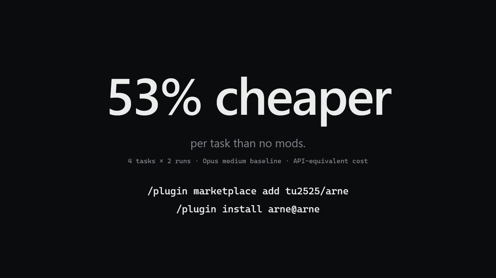

# arne

A Claude Code plugin that sends each prompt and each subagent run to the cheapest model and effort that can handle it (Haiku 5.5, Sonnet 5.5 or Opus 5.5). It manages the cache, compaction and model switches around that choice. Every choice shows in the band above the prompt and is logged with its cost to `~/.claude/arne/decisions.jsonl`, which stays on your machine. `/arne` overrides it.

arne replaces effortless by HeyCubit (MIT). Its cost ratios and the bench below come from effortless. Turn effortless off while arne is on.

[](demo/arne.mp4)

## Install

```
/plugin marketplace add tu2525/arne
/plugin install arne@arne
```

Then disable effortless if you have it, and restart.

## Use

The band above the prompt is the control: **● Auto** turns routing on or off (or resumes it after you pick a model yourself), the model and effort pickers pin a choice (Auto unpins), **why** shows the last decision with 👍/👎, **cache** shows what a cold cache will cost, and **⚙** opens the settings. The same settings live in `/config`.

`/arne` covers the same ground from the prompt: `on`, `off`, `pin haiku|sonnet|opus [low|medium|high]`, `unpin`, `handoff`, `subagents auto|haiku|sonnet|opus|off`, `why`, `log`, `stats`, `backend haiku|heuristic|laya|jev`, `settings`. A pin belongs to its chat: a new chat starts on Auto.

**Jev** is TypeSafe's hosted judge, off by default. Pick it and your prompts and the task card leave this machine. Set the key in /config (arne → TypeSafe API key, kept in secure storage, never in settings.json) or `TYPESAFE_API_KEY`, which wins when both are set; make one at console.typesafe.ai/keys. Without a key, Settings says so and Haiku judges. Stats counts Jev's calls in tokens, since its prices aren't published.

**Stats** (the band's panel → Settings → Stats, or `/arne stats`) shows what arne saved today, over 7 days and in all. It is an estimate, never an exact figure: each turn's real tokens are priced again as if the turn ran on Opus or Sonnet at medium effort. A different model would have written a different answer, so the real difference can't be known. Model switches and summaries count against arne, and turns logged before Stats existed are skipped.

**Handoff** (the band's panel, the cold and heavy alerts, or `/arne handoff [haiku|sonnet|opus]`) has Haiku summarize the chat into `arne-handoff.md` and the clipboard, runs `/clear`, moves to the tier you picked and sends the summary as the new chat's first message. The old chat stays in history; plugins can't archive a chat, so archiving it from the sidebar is your click. When a cheaper model fits but switching on a warm cache costs more than it saves, the panel prices staying, switching and a handoff side by side. In a chat past the cold-offer size (30k tokens by default) the main panel also shows one line per cheaper tier: what a handoff costs now and how many turns until it breaks even.

**Subagents** get their model when they start, at medium effort or more, never dearer than the chat that sent them or the **Subagents** ceiling in Settings (`Auto · Haiku · Sonnet · Opus · Off`, default Auto, which is no ceiling; also `/arne subagents auto|haiku|sonnet|opus|off`). A model the call asked for ("use haiku to write this") runs as asked when it is at or under the ceiling; a dearer one runs on the ceiling, and the Agent call says "arne: Sonnet (capped from Opus)". Forks, teammates and workflow agents are left alone, and Off leaves every subagent alone. When arne moves one, it says so on the Agent call, and the band's panel counts this chat's subagents.

**Plugins can't move the app's model menu.** arne switches with the real `/model`, but the desktop app's model menu can keep showing your last pick; the band is the model that actually runs.

## Credits

effortless by HeyCubit is MIT-licensed. arne reuses its cost formulas and its bench tasks; its licence is in [bench/LICENSE.effortless](bench/LICENSE.effortless).

## License

MIT, see [LICENSE](LICENSE).

## Bench vs effortless

effortless's own `bench/agentic` tasks (MIT): four real coding tasks on effortless's source. They find a threshold, add JSDoc to one file without touching code, write and run a test-counting script, and explain the update flow. The app was on Opus · medium every time, set up three ways:

- **no mods:** no plugin loaded
- **effortless:** effortless loaded
- **arne:** arne loaded, with its log and settings paths pointed into the bench folder so the real log is never touched

Each setup ran 2 times per task, one after another, through `claude -p --setting-sources project`, which keeps user plugins and hooks out. Run it again with `bash bench/agentic/run.sh 2`, then `node bench/agentic/score.cjs`.

| Setup | Runs | Correct | Correct, harness denials excluded | API-equivalent cost | Per task | Avg requests | Avg time |
| --- | --- | --- | --- | --- | --- | --- | --- |
| Opus medium, no mods | 8 | 8 | 8 | $1.71 | $0.214 | 7.4 | 30 s |
| effortless | 8 | 6 | 8 | $1.23 | $0.153 | 7.1 | 28 s |
| arne | 8 | 6 | 7 | $0.80 | $0.100 | 7.9 | 29 s |

arne costs 53% less per task than no mods and 35% less than effortless.

**About the cost.** The runs used a logged-in Claude plan. The costs are `total_cost_usd` from each run, which is the list-price equivalent, not what the plan was billed.

**Harness denials.** In 3 runs (effortless 2, arne 1), the session refused `node tools/count-tests.mjs` even though `Bash(node:*)` was allowed, so the agent wrote the script but couldn't run it. That's the bench harness, not the model.

**Where arne missed.** Step 17's pass condition is "correct on everything", and arne missed it on one run. arne sent the JSDoc task (t2) to Haiku · low in both reps, and Haiku skipped one export once. Raising the floor for multi-edit tasks, or tuning Laya on these rows, should close it.

**Fewer reps than planned.** PLAN.md asks for 3 runs per setup. This bench ran 2 to save plan limits.
