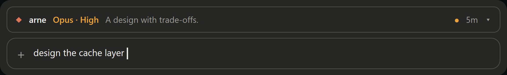
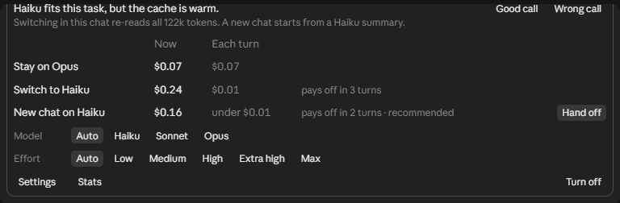
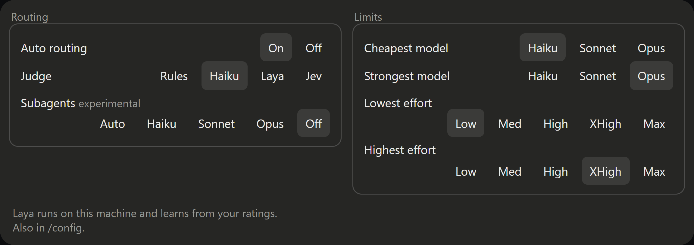
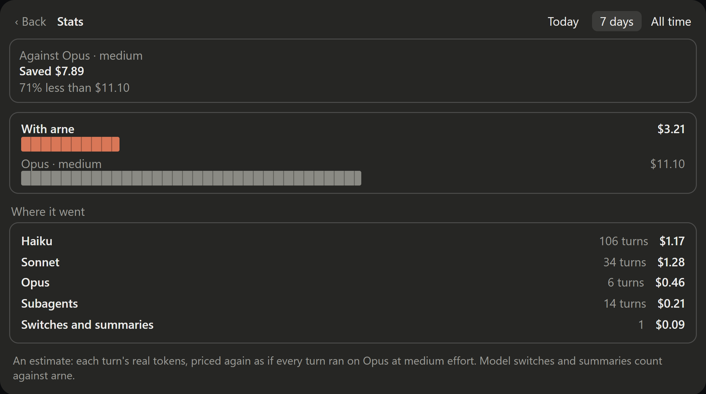
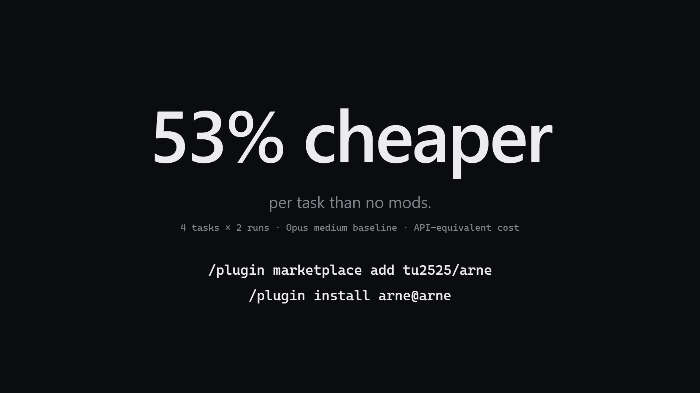

# arne

**a**uto **r**oute a**n**d **e**ffort

**Your typo fix doesn't need Opus.** arne is a Claude Code plugin that sends each prompt to the cheapest model and effort that can handle it (Haiku 5.5, Sonnet 5.5 or Opus 5.5), and does the cache math before you switch or hand off a big chat.

In real use, arne cost about **38% less** than running every turn on Opus: $290.02 against $469.65 at list prices, over 1,397 turns in four weeks (20 October to 16 November 2026). That is one person's log and an estimate from `/arne stats`. The baseline is all-Opus, so if you would have used Sonnet anyway, you save less. For the bench, see [Bench](#bench).


https://github.com/user-attachments/assets/20300835-8253-4130-91c0-946e7c5370c5


## What it does

- **Routes every prompt.** A small judge (Haiku by default) reads the prompt and picks a tier and effort. A rename goes to Haiku · low, and a design question goes to Sonnet · high. The judge stops at Sonnet. Opus is reached only after a failed attempt, or when you pin it.
- **Shows its work.** The band above the prompt shows the model that's running and why it was picked. Every decision is logged with its cost under `~/.claude/arne/log/`, which never leaves your machine (see `/arne log`). Prompts are stored there in plain text, in one file per day and chat, with the first 4,000 characters of each prompt kept.
- **Knows when switching costs more than staying.** On a warm cache, moving a big chat to a cheaper model can cost more than it saves. arne prices staying, switching and a handoff side by side.
- **Hands off cleanly.** Haiku summarizes the chat to your clipboard so you can continue in a fresh chat on a cheaper tier.
- **Stays out of the way.** Pin a model whenever you want, and the pin lasts for that chat. `/arne off` turns routing off.

## Screenshots

These images are rendered from an HTML mock of the UI, not captured from the app.

The band above the prompt shows the model that's running and why it was picked:



Open the band to see the cost of staying, switching or handing off, and to pin a model or effort:



Settings, where you choose the judge and the cheapest and strongest model and effort arne may use:



Stats, which estimates what arne saved (shown here with example data):



## Install

```
/plugin marketplace add tu2525/arne
/plugin install arne@arne
```

Restart Claude Code afterwards. If you use effortless, turn it off first, because arne replaces it.

## Use

The band above the prompt is the control:

| Control | What it does |
| --- | --- |
| **● Auto** | Turns routing on or off, or resumes it after you pick a model yourself |
| model / effort | Pins a choice for this chat (Auto unpins) |
| **why** | Shows the last decision, with 👍/👎 to rate it |
| **cache** | Shows what a cold cache will cost |
| **⚙** | Settings (also in `/config`) |

`/arne` does the same from the prompt: `on`, `off`, `pin haiku|sonnet|opus [low|medium|high|xhigh|max]`, `unpin`, `handoff`, `subagents auto|haiku|sonnet|opus|off`, `why`, `log`, `stats`, `backend haiku|heuristic|laya|jev`, `settings`, `debug` (cache state and the numbers behind the band) and `show` (draws the band in a sample state until `/arne show live`).

### Fable

arne has no tier for Fable, so in a chat on Fable it stands by: no judge call, no effort change, nothing logged for those turns.
At the start of such a chat the band asks once: **Stay on Fable** or **Let arne route**.
Choosing the second lets arne move the chat to Haiku, Sonnet or Opus from the next prompt.

### Handoff

Open it from the band's panel, from the cold-cache and heavy-chat alerts, or with `/arne handoff [haiku|sonnet|opus]`. Haiku summarizes the chat into `arne-handoff.md` and copies it to the clipboard. The **Handoff** setting decides what happens next:

- **New chat** (default): you open a new chat on the tier you picked and paste the summary. The old chat stays as it is. Plugins can't open a chat or paste into one for you.
- **Clear:** arne runs `/clear`, switches tier and sends the summary as the first message. The old chat is saved to `arne-archive/` first.

Once a chat passes 30k tokens, the panel shows one line per cheaper tier: what a handoff costs now, and how many turns until it pays off.

### Stats

Open it from the band's panel (Settings → Stats) or with `/arne stats`. It shows an estimate of what arne saved today, over the last 7 days and in total. To get it, each turn's real tokens are priced again as if the turn had run on Opus at medium effort. The figure can't be exact, because a different model would have written a different answer. Model switches and summaries are counted against arne.

### Subagents (experimental)

This is on by default, capped at Sonnet (set it to `off` to leave subagents alone). When it's on, a subagent gets its model when it starts. The model is at medium effort or more, and never dearer than the chat that sent it or the **Subagents** ceiling in Settings. If the call asks for a model under the ceiling, that model runs. A dearer one is capped, and the Agent call says so (for example, "arne: Sonnet (capped from Opus)"). Forks, teammates and workflow agents are always left alone.

### Judges

| Backend | Where it runs |
| --- | --- |
| `haiku` (default) | Your Claude session |
| `heuristic` | No judge: keeps the last tier, otherwise Sonnet · medium |
| `laya` | A local `laya-serve` |
| `jev` | TypeSafe's hosted judge. Your prompt, the chat's first prompt, the last ten messages, the paths of the last 15 files touched and the chat's size leave your machine. You need a key from console.typesafe.ai/keys, set in /config (kept in secure storage) or in `TYPESAFE_API_KEY` |

### Known limit

Plugins can't move the desktop app's model menu. arne switches with the real `/model`, but the menu can keep showing your last pick. The band always shows the model that's actually running.

## Bench

**Latest results: [bench/agentic/FINDINGS.md](bench/agentic/FINDINGS.md).** It covers 5 reps per task, a 5-prompt chat test, pinned and effortless setups, the method, every test prompt and how it's checked, and how to send us your own numbers. Short version: arne cost $0.047 per task against $0.228 on Opus, and $0.021 per chat against $0.599, at about the same pass rate. These runs predate 0.4.x, and Haiku passes every task in the bench, so the bench shows that Haiku is cheap, not that arne picks a bigger model when it should. The first run, below, is kept for history.

These are effortless's own `bench/agentic` tasks (MIT): four real coding tasks on effortless's source. They find a threshold, add JSDoc without touching code, write and run a test-counting script, and explain an update flow. Every run started on Opus · medium. There were three setups, with 2 runs per task each, through `claude -p --setting-sources project`, which keeps user plugins out.

| Setup | Runs | Correct | Correct, harness denials excluded | API-equivalent cost | Per task | Avg requests | Avg time |
| --- | --- | --- | --- | --- | --- | --- | --- |
| Opus medium, no mods | 8 | 8 | 8 | $1.71 | $0.214 | 7.4 | 30 s |
| effortless | 8 | 6 | 8 | $1.23 | $0.153 | 7.1 | 28 s |
| arne | 8 | 6 | 7 | $0.80 | $0.100 | 7.9 | 29 s |

[](demo/poster.png)

- **Cost** is `total_cost_usd` from each run, which is the list-price equivalent. It isn't what a Claude plan bills.
- **Harness denials:** in 3 runs (effortless 2, arne 1), the session refused `node tools/count-tests.mjs` even though it was allowed. The agent wrote the script but couldn't run it.
- **Where arne missed:** arne sent the JSDoc task to Haiku · low, and once Haiku skipped an export. Raising the floor for multi-edit tasks should fix it.
- **Sample size:** 2 runs per setup is small. To run it yourself: `bash bench/agentic/run.sh 2`, then `node bench/agentic/score.cjs`.

## Credits

arne replaces [effortless](bench/LICENSE.effortless) by HeyCubit (MIT), and reuses its cost formulas and bench tasks.

The icons in the apps are from [Lucide](https://lucide.dev) (ISC, © Lucide Contributors).

## License

MIT, see [LICENSE](LICENSE).
